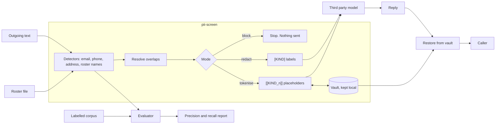

# pii-screen

Customer messages are full of phone numbers, emails, street addresses and names, and it is easy to paste them into a prompt for a third party model without thinking.
pii-screen sits in front of that call and blocks, redacts or swaps out those details first, and it measures how well it does so on a labelled test corpus.

## What it does

- **Detects** four kinds of detail: phone numbers, email addresses, street addresses, and names from a roster you supply (one name per line). Names are never guessed; only roster names are looked for.
- **Three modes**
  - `block`: if anything is found, nothing is passed on. The CLI exits with code 2.
  - `redact`: each finding becomes `[PHONE]`, `[EMAIL]`, `[ADDRESS]` or `[NAME]`. One way.
  - `tokenise`: each finding becomes a numbered placeholder such as `[[NAME_1]]`. The same value always gets the same placeholder, and a vault kept on your side maps them back, so the model's reply can be restored.
- **Measures itself**: ships a labelled synthetic corpus (110 messages, 177 labelled spans) and reports precision and recall per kind.
- Library and CLI. Standard library only, no dependencies, no network calls.

```python
from pii_screen import Roster, Screener, guarded_call

screener = Screener(Roster.from_file("corpus/roster.txt"))

result = screener.screen("Call Alex Sample on 555-555-0142", mode="tokenise")
result.text                        # 'Call [[NAME_1]] on [[PHONE_1]]'
result.vault.restore(result.text)  # 'Call Alex Sample on 555-555-0142'

# Or wrap the model call. send() only ever sees the screened text.
reply = guarded_call(screener, message, send=my_model_client, mode="tokenise")
```

## Architecture



| Path | Purpose |
| --- | --- |
| `pii_screen/detectors.py` | Patterns for email, phone and address; roster name matcher; overlap resolution |
| `pii_screen/screen.py` | `Screener`, the three modes, `Vault`, `guarded_call` |
| `pii_screen/evaluate.py` | Scores the screen against the corpus |
| `pii_screen/cli.py` | `screen`, `restore`, `eval` commands |
| `pii_screen/mock_model.py` | Offline stand-in for a model, used by the tests and the demo |
| `corpus/` | `build_corpus.py` (labels written inline), the generated `corpus.jsonl`, and `roster.txt` |

## Run it

Needs Python 3.10 or newer. Nothing to install.

```bash
echo "Call Alex Sample on 555-555-0142" | python -m pii_screen screen --roster corpus/roster.txt --vault vault.json
python -m pii_screen eval --errors
python demo/run_demo.py
```

More CLI examples:

```bash
python -m pii_screen screen message.txt --mode redact
python -m pii_screen screen message.txt --mode block          # exit code 2 if anything is found
python -m pii_screen restore reply.txt --vault vault.json     # swap placeholders back
python -m pii_screen eval --full-names-only                   # stricter name matching
```

`pip install -e .` also gives you a `pii-screen` command. Defaults for mode and roster can come from the environment, see `.env.example`. Findings are logged to stderr by kind and position only, never by value.

## Tests

```bash
python -m unittest discover -s tests -v
```

41 tests cover each detector, the three modes, vault round trips, the guarded model call, the scoring maths, the CLI, and a check that the shipped corpus matches its builder. CI (`.github/workflows/ci.yml`) runs the same on Python 3.10 and 3.12, then runs the eval and the demo.

## Demo

`python demo/run_demo.py` runs offline with no key. It screens one synthetic message in all three modes, sends the tokenised version through the mock model and restores the reply, shows block mode stopping the call, and prints the precision and recall report. Captured output is in [`demo/output.txt`](demo/output.txt). The core of it:

```
Original:   Alex Sample called from (555) 555-0142 about the leak at 123 Example Street. Send the quote to alex.sample@example.com. Alex is home after 4.
Redact:     [NAME] called from [PHONE] about the leak at [ADDRESS]. Send the quote to [EMAIL]. [NAME] is home after 4.
Tokenise:   [[NAME_1]] called from [[PHONE_1]] about the leak at [[ADDRESS_1]]. Send the quote to [[EMAIL_1]]. [[NAME_2]] is home after 4.
Restored model reply:
            Draft reply: Hello Alex Sample, thanks for your message (19 words). We can send someone to 123 Example Street. We will confirm the time using (555) 555-0142.
```

## Precision and recall

Measured on the shipped corpus with the shipped roster, default settings:

```
Exact span match (kind, start and end all equal)
kind       gold  pred    tp    fp    fn  precision  recall     f1
EMAIL        35    34    34     0     1      1.000   0.971  0.986
PHONE        49    48    45     3     4      0.938   0.918  0.928
ADDRESS      38    36    35     1     3      0.972   0.921  0.946
NAME         55    57    50     7     5      0.877   0.909  0.893
ALL         177   175   164    11    13      0.937   0.927  0.932
```

With `--full-names-only`, name precision rises to 1.000 and name recall falls to 0.782, because a first name on its own is no longer matched.

Read these numbers for what they are. The corpus has 70 template generated messages and 40 hand written ones. The generated messages use formats the patterns were written for, and the screen gets all of them. Every error comes from the hand written set, which was built on purpose to include things the screen misses (a spelled out email, a phone number with odd spacing, a lowercase street address, a misspelled name), things it flags wrongly (a part number that looks like a phone number, "Sample photos" when a roster surname is "Sample"), and clean messages. So the figures show where the edges are. They are not a forecast of accuracy on your own traffic. Label a sample of your own messages in the same JSONL format and run `eval --corpus yours.jsonl --roster yours.txt` to find out.

## Where this pattern runs

This is drawn from systems that run two small service companies day to day, where customer messages, job notes and call summaries are routinely handed to hosted models for drafting and summarising. A screen like this one sits in front of those calls so that contact details and the names of known customers and staff stay on the company's side.

## Limitations

- **Pattern based.** Anything written in an unexpected form gets through: "alex at example dot com", digits spelled as words, phone numbers with unusual spacing, lowercase street addresses, addresses with no house number first.
- **Names come only from the roster.** A person who is not on the roster is not detected at all, and the corpus does not label such names. Misspellings and initials are only partly caught.
- **Single name parts cause false positives** when a roster name is also an ordinary capitalised word. Use `--full-names-only` (or `Roster(..., match_parts=False)`) to trade recall for precision.
- **North American formats only** for phones and street addresses. No international numbers, no non English address styles.
- **Only four kinds of detail.** No account numbers, government ids, dates of birth, payment cards or free text that identifies someone indirectly.
- **No coreference.** "Alex Sample" and a later "Alex" get different placeholders, so the model cannot tell they are one person.
- **Exact string keys.** The same phone number in two formats gets two placeholders.
- **The vault is sensitive.** It holds the real values in plain JSON. Keep it local, do not commit it, and delete it when the exchange is over.
- **Not a compliance tool.** It lowers the chance of sending personal details by accident. It does not guarantee that none are sent, and a blocked or clean result is not proof that a text is free of personal data.

License: MIT, see the LICENSE file.
